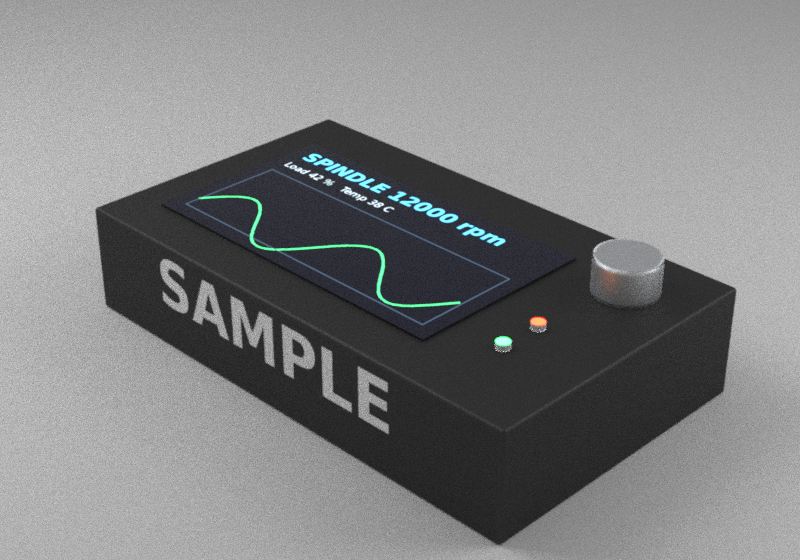

# Example: a small device with a screen, LEDs, a decal and real finishes

Everything the SolidCraft → LuxCore exporter can add on top of a model's own looks, on one
part. All files are original (images drawn with `make_images.py`, DejaVu Sans font).

| File | What |
|---|---|
| `device.json` | SolidCraft script: housing, screen, two LEDs, knob; physical materials with PBR looks |
| `render.json` | render-only additions: finishes, bevel, a display image, two LEDs, a decal |
| `screen.png` | what the display shows (640x360, same 16:9 as its 80 x 45 mm frame) |
| `decal.png` | the logo, white on transparent (512x128, same 4:1 as its 80 x 20 mm frame) |
| `make_images.py` | regenerates both images |
| `expected.png` | the render below, for comparison |

```bash
export SOLIDCRAFT_CLI=$HOME/solidcraft-bin/solidcraft-cli
X=../../scripts/solidcraft_to_luxcore.py
python3 $X device.json --overrides render.json --out /tmp/r/device \
  --width 800 --height 560 --spp 64 --exposure 1
luxcoreconsole -d /tmp/r/device render.cfg        # ~30 s on 4 threads
```

What each part of `render.json` does:
- `materials`: every ABS body gets the `plastic-textured` finish (moulded grain); its colour
  still comes from the ABS look in `device.json`, so one line covers ABS parts of any colour.
- `bodies`: the knob gets `aluminium-blasted` (its SolidCraft look is plain aluminium).
- `bevel`: 0.8 mm on everything, 0.2 mm on the LEDs, none on the 0.6 mm screen.
- `emitters`: the screen's top face shows `screen.png` (placed by `frame`); the LEDs' top
  faces glow green and red in light group 3.
- `decals`: `decal.png` on the housing's front face, 0.02 mm above it.

Checked 2026-11-13 with solidcraft-cli 0.27.1 and the luxcore-cli-2026-11-13 build (the
bevel needs that build: the LEDs' remaining surfaces have no convex edge, which crashed
older builds).


